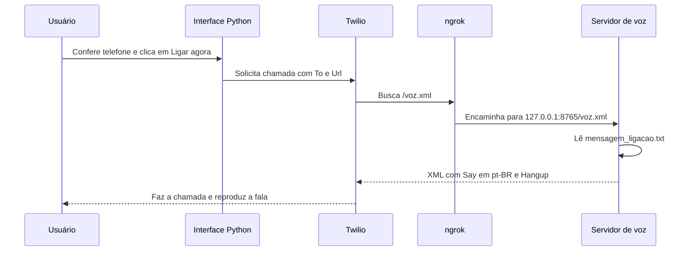

# Guia completo: fala personalizada em português com Python, ngrok e Twilio

Este guia explica a instalação inicial, a rotina para ligar e os erros mais comuns.
O caminho principal usa o modo `trial`, um roteiro em arquivo TXT e uma URL HTTPS
fornecida pelo ngrok. Não é necessário criar um TwiML Bin para este fluxo.

## 1. Entender o que cada parte faz

| Parte | Função | Endereço ou arquivo |
| --- | --- | --- |
| Roteiro | Guarda o texto que será lido | `mensagem_ligacao.txt` |
| Servidor Python | Converte o roteiro em instruções XML/TwiML | `servidor_voz.py`, porta 8765 |
| ngrok | Disponibiliza esse servidor por uma URL HTTPS pública | `https://SEU-DOMINIO.ngrok-free.dev` |
| Twilio | Liga para o destino e busca as instruções de voz | Console ou API de Voice |
| Interface do projeto | Permite solicitar, consultar e encerrar uma chamada | `ligacao_interface.py`, porta 8501 |



O programa reproduz um roteiro com voz sintetizada. Ele não cria respostas por IA
nem mantém uma conversa com quem atende. O arquivo TXT é compartilhado: se você
alterá-lo antes de a Twilio buscar o XML de uma chamada na fila, ela poderá ler o
novo conteúdo. Este fluxo foi feito para testes individuais.

## 2. Obter o projeto

Se já está na pasta abaixo, pule o clone. Para uma instalação nova, abra o PowerShell:

```powershell
cd "C:\Users\cmath\OneDrive\Desktop\PROJETOS\BB Dataton"
git clone --branch codigo-ligacao --single-branch https://github.com/0mthsxz0/BB-Dataton.git BB-Dataton
cd BB-Dataton
```

Para entrar em uma cópia já existente:

```powershell
cd "C:\Users\cmath\OneDrive\Desktop\PROJETOS\BB Dataton\BB-Dataton"
```

Essa pasta contém `servidor_voz.py`, `ligacao_interface.py` e `mensagem_ligacao.txt`.
Os caminhos acima correspondem à instalação deste computador. Em outro computador,
substitua-os pela pasta onde você clonou o repositório.

Para atualizar uma cópia sem alterações locais pendentes:

```powershell
git switch codigo-ligacao
git pull --ff-only
```

Se você já personalizou arquivos, confira `git status` e preserve suas alterações
antes de atualizar. Não descarte o roteiro editado para resolver um conflito.

## 3. Preparar o Python uma vez

Use Python 3.12 ou 3.13. Confira a instalação:

```powershell
python --version
```

Se `python` abrir a Microsoft Store, mas o inicializador Python estiver instalado,
tente `py -3.12 --version`. O Python pode ser obtido em [python.org](https://www.python.org/downloads/windows/).

Dentro da pasta do projeto:

```powershell
python -m venv .venv
.\.venv\Scripts\python.exe -m pip install -r requirements.txt
```

Se você utiliza o inicializador `py`, apenas a criação muda para:

```powershell
py -3.12 -m venv .venv
```

Não é necessário ativar o ambiente: os comandos deste guia chamam o executável da
`.venv` diretamente. Se a `.venv` e as dependências já estão prontas, pule esta etapa.

## 4. Editar a mensagem

Abra `mensagem_ligacao.txt` no VS Code ou no Bloco de Notas. Por exemplo:

```text
Olá! Esta é uma ligação de demonstração do nosso projeto.
Estamos entrando em contato para apresentar nossa solução.
Obrigado por atender. Tenha um ótimo dia!
```

Salve o arquivo em UTF-8. Ele aceita até 1500 caracteres; textos com muitos símbolos
podem atingir antes o limite do XML escapado. Não coloque senhas, tokens ou dados
privados no roteiro: a URL de voz é pública e o arquivo é versionado neste projeto.

A função `criar_twiml()` em `ligacoes.py` transforma esse texto em:

```xml
<Response>
  <Say voice="Polly.Camila" language="pt-BR">Seu texto aparece aqui.</Say>
  <Hangup />
</Response>
```

O servidor relê o arquivo a cada solicitação. Basta salvar para mudar a próxima
fala; não precisa reiniciar o servidor. O idioma é `pt-BR`; o projeto usa a voz
`Polly.Camila`. O aviso do navegador sobre o XML não ter estilo é normal.

## 5. Terminal 1: iniciar o servidor de voz

Abra um PowerShell na pasta do projeto e execute:

```powershell
.\.venv\Scripts\python.exe servidor_voz.py
```

Mantenha esse terminal aberto. No navegador, teste:

[http://127.0.0.1:8765/voz.xml](http://127.0.0.1:8765/voz.xml)

O resultado deve ser um XML com `<Response>`, `<Say>` e sua mensagem. O endereço
`http://127.0.0.1:8765/` sem `/voz.xml` retorna 404 por projeto. O servidor entrega
somente a rota de voz, aceita GET e POST e não disponibiliza a pasta inteira.

Se a porta 8765 já estiver em uso e o XML estiver funcionando, o servidor já está
ligado; não abra uma segunda instância. Este servidor não inicia ligações sozinho.

## 6. Instalar e autenticar o ngrok uma vez

1. Crie uma conta em [ngrok](https://dashboard.ngrok.com/signup).
2. Siga a [instalação oficial para Windows](https://ngrok.com/download/windows).
3. Abra [Your Authtoken](https://dashboard.ngrok.com/get-started/your-authtoken).
4. Copie seu token e execute no terminal:

```powershell
ngrok config add-authtoken "SEU_TOKEN_DO_NGROK"
```

O token do ngrok autentica o túnel; o Auth Token da Twilio autentica chamadas.
São credenciais diferentes. Não envie nenhuma delas pelo chat, por captura de tela
ou para o GitHub. O ngrok salva sua própria configuração fora dos arquivos do app.

Confira se a instalação está acessível:

```powershell
ngrok version
```

Se `ngrok` não for reconhecido, reabra o terminal após a instalação. Se você baixou
apenas `ngrok.exe`, execute-o pelo caminho completo, por exemplo:

```powershell
& "C:\CAMINHO\ngrok.exe" version
```

Substitua esse caminho pela localização real do executável. Abrir o `.exe` sem
argumentos pode mostrar apenas a ajuda; isso não significa que o túnel foi iniciado.

## 7. Terminal 2: iniciar o túnel

Com o servidor Python ainda ligado, abra outro terminal:

```powershell
ngrok http 8765
```

Mantenha essa janela aberta. Procure a linha **Forwarding**, semelhante a:

```text
Forwarding  https://SEU-DOMINIO.ngrok-free.dev -> http://localhost:8765
```

Use exatamente o domínio mostrado pelo seu ngrok. O sufixo pode variar conforme a
conta e a configuração. Não presuma que o endereço de um exemplo está disponível.
O status deve estar **online**. O painel local normalmente fica em
[http://127.0.0.1:4040](http://127.0.0.1:4040) e também mostra o endereço público.

Acrescente `/voz.xml` ao endereço HTTPS:

```text
https://SEU-DOMINIO.ngrok-free.dev/voz.xml
```

Abra esse link e confira se retorna o mesmo XML em português. Se o navegador
mostrar a página informativa do ngrok, confirme o acesso ao seu próprio endpoint
e confira o conteúdo. A verificação real da Twilio ainda precisa retornar XML.
Não configure autenticação de navegador, como OAuth, na URL que a Twilio precisa
buscar automaticamente.

O túnel deve apontar para a porta **8765** do servidor de voz. A porta **8501** é a
interface Streamlit e deve continuar local. O endpoint HTTPS disponibiliza o
roteiro, sem conter Account SID ou Auth Token.

## 8. Preparar a Twilio e verificar o destinatário

1. Entre no [novo console da Twilio](https://1console.twilio.com/) com sua conta.
2. Na página inicial, procure **Make a voice call**, marcado **Try for free**.
   Role a página se o cartão estiver depois de SMS, WhatsApp e e-mail.
3. Abra **Try out Voice** e a aba **Start a call**.
4. Em **To**, selecione ou adicione o telefone que vai receber a chamada.
5. Complete a verificação desse destinatário, conforme solicitado pela Twilio.
6. Confira a origem de teste atribuída ao destinatário na própria tela.

No trial, o destino precisa estar verificado e dentro das restrições geográficas
da conta. O telefone deve usar o formato E.164: `+`, código do país, DDD e número,
sem espaços ou pontuação. O trial tem limite de duração e minutos controlado pela
Twilio; confira o contador do seu console.

O TwiML Bin pode estar indisponível na conta trial. Este guia usa um servidor
próprio e o campo **Custom TwiML URL**. A aceitação de uma URL externa depende das
permissões da conta e deve ser confirmada por uma chamada real.

## 9. Fazer o primeiro teste pelo console

1. Na janela **Try out Voice**, selecione **Custom** em **Call options**.
2. No campo **Custom TwiML URL**, cole:

```text
https://SEU-DOMINIO.ngrok-free.dev/voz.xml
```

3. Confira que **To** é o telefone correto, verificado e autorizado para o teste.
4. Clique em **Start call**. Esse clique faz uma ligação real.
5. Atenda ao telefone e confira a mensagem. O provedor pode incluir um aviso próprio
   do trial antes da fala; idioma e conteúdo desse aviso são controlados pela Twilio.
6. Veja o resultado em **Logs** ou na resposta da API mostrada pelo console.

Selecionar **Quick tests** e **Speech Recognition** chama a demonstração de
reconhecimento de voz, e não seu arquivo TXT. Para este roteiro, use **Custom**.
Não é necessário comprar um número para seguir a configuração de origem de teste
oferecida pela Twilio à sua conta.

## 10. Terminal 3: ligar pela interface Python

Mantenha o servidor e o ngrok ligados. Abra um terceiro PowerShell na pasta do
projeto. Se o Streamlit já estiver rodando nesse terminal, pressione Ctrl+C antes.

Defina as credenciais da Twilio e a URL do roteiro:

```powershell
$env:TWILIO_ACCOUNT_SID="AC_SEU_ACCOUNT_SID"
$env:TWILIO_AUTH_TOKEN="SEU_AUTH_TOKEN_DA_TWILIO"
$env:TWILIO_MODE="trial"
$env:TWILIO_TWIML_URL="https://SEU-DOMINIO.ngrok-free.dev/voz.xml"
.\.venv\Scripts\python.exe -m streamlit run ligacao_interface.py --server.address 127.0.0.1
```

Copie Account SID e Auth Token no painel da Twilio. Substitua todos os exemplos
pelos seus valores reais apenas no terminal. As variáveis pertencem ao processo:
devem ser definidas no mesmo terminal em que você inicia o Streamlit. Fechar esse
PowerShell não guarda essas variáveis para a próxima sessão.

Abra [http://127.0.0.1:8501](http://127.0.0.1:8501). A tela deve mostrar **Modo teste
com fala personalizada**. Informe o mesmo destinatário verificado, marque a
confirmação e clique em **Ligar agora**. Consulte o status depois de atender ou
encerrar. Uma solicitação aceita não garante atendimento; `completed` pode incluir
caixa postal. Consulte a documentação [LIGACOES.md](LIGACOES.md) para detalhes da API.

No trial, o código envia `To` e `Url`. Não envia o TXT na requisição de criação:
a Twilio busca o XML pelo endereço público. `TWILIO_FROM_NUMBER` não é necessário
neste fluxo. `TWILIO_MODE=completo` é outro modo, destinado à API completa da conta;
não o selecione para tentar remover restrições do trial.

O arquivo `.env.example` documenta as variáveis, mas não é carregado automaticamente.
Alterar uma variável em outro terminal não muda um app já aberto. Reinicie o
Streamlit no terminal configurado e atualize a página do navegador.

## 11. Rotina para usar em outro dia

| Ordem | Janela | Ação |
| --- | --- | --- |
| 1 | Editor | Edite e salve `mensagem_ligacao.txt` |
| 2 | Terminal 1 | Execute `servidor_voz.py` e confira `/voz.xml` local |
| 3 | Terminal 2 | Execute `ngrok http 8765` e copie o HTTPS ativo |
| 4 | Navegador | Confira o XML no endereço público com `/voz.xml` |
| 5 | Terminal 3 | Defina as variáveis e inicie o Streamlit |
| 6 | Interface | Confira o telefone e solicite a chamada |

O ngrok pode reutilizar um domínio atribuído à conta, mas sempre confira o endereço
ativo em **Forwarding**. Se ele mudar, atualize **Custom TwiML URL** no console e
`TWILIO_TWIML_URL` no terminal, reiniciando o app. O computador deve ficar ligado
com conexão à internet durante os testes.

Para terminar, pare o ngrok, o servidor de voz e o Streamlit com Ctrl+C nos seus
respectivos terminais. Encerrar o túnel remove a conectividade para o computador,
mesmo que o domínio continue associado à conta. Isso não apaga os registros da Twilio.

## 12. Diagnóstico de problemas

| Sintoma | O que conferir |
| --- | --- |
| `.venv\Scripts\python.exe` não reconhecido | Entre na raiz do projeto e crie a `.venv` com um Python instalado. |
| `No module named streamlit` | Instale `requirements.txt` usando o Python da própria `.venv`. |
| `ngrok` não reconhecido | Reabra o terminal ou use o caminho completo do executável. |
| ngrok mostra apenas a ajuda | Execute `ngrok http 8765`; abrir o programa sozinho não cria o túnel. |
| ngrok pede autenticação | Configure seu token com `ngrok config add-authtoken`. |
| 404 ao abrir a URL | Acrescente `/voz.xml`; a rota `/` não serve o roteiro. |
| 503 no XML | Confira se o TXT existe, está em UTF-8, não está vazio e respeita o limite. |
| Endereço público falha, mas local funciona | Confira ngrok online, porta 8765 e o domínio atual em Forwarding. |
| Porta 8765 ocupada | Teste o XML local; talvez o servidor já esteja aberto. Evite duas instâncias. |
| Porta 8501 ocupada | Use o app já aberto ou encerre a instância anterior do Streamlit. |
| App pede credenciais novamente | Defina SID e token no mesmo terminal que inicia o Streamlit. |
| Ligação fala a demonstração em inglês | Confira TWILIO_TWIML_URL, o XML público e a opção Custom no console. |
| Twilio 573002 | Verifique o destino em Try out Voice e conclua sua atribuição de origem de teste. |
| Twilio 20003 | Confira SID e Auth Token da mesma conta; atualize um token que foi trocado. |
| Twilio 21219 | O destinatário ainda precisa ser verificado para uso no trial. |
| HTTP 400 com parâmetros não permitidos | Use trial com URL; não envie parâmetros da API completa como Twiml e TimeLimit. |
| Envio ficou sem confirmação | Confira os logs antes de repetir: a chamada pode ter sido aceita. |
| TwiML Bin exige upgrade | Use o servidor próprio deste guia no campo Custom TwiML URL. |

Para investigar a busca do XML, abra `http://127.0.0.1:4040` e veja se houve uma
requisição a `/voz.xml` com resposta 200. Esse painel é local e não é a URL que vai
na Twilio. Se houver uma recusa da API de chamadas, preserve o texto do erro exibido
pelo app, sem compartilhar tokens ou dados pessoais do console.

Cloudflare Tunnel é uma alternativa opcional. Na rede testada, conexões à porta
7844 falharam, e por isso usamos ngrok. A escolha do túnel não muda o roteiro nem
o servidor Python. Não é necessário alterar firewall para seguir este guia com ngrok.

## 13. Dados locais e publicação

Versione o código, documentação e um roteiro de exemplo. Não publique Auth Token,
authtoken do ngrok, `.env`, `.streamlit/secrets.toml`, configurações locais do ngrok,
executáveis de ferramentas ou a `.venv`. Se uma credencial já foi compartilhada,
troque-a no respectivo provedor e atualize sua configuração local.

O endpoint de voz aceita GET/POST sem autenticação e é destinado a demonstração.
Quem conhecer a URL pode ler o roteiro. O Streamlit deve ficar em 127.0.0.1, e as
credenciais devem permanecer no processo local que solicita chamadas. O acesso ao
servidor XML não permite disparar ligações por esse endpoint.

## 14. Testes e limites de validação

```powershell
.\.venv\Scripts\python.exe -m pytest tests -q
```

A suíte cobre validação dos pedidos, tratamento de erros, interface, rota HTTP e
releitura do TXT. Os testes simulam a API da Twilio e não consomem minutos. O XML
público foi verificado durante a configuração; essa verificação não comprova o
atendimento nem o áudio de uma chamada feita com a URL personalizada. Confirme a
chamada real seguindo a etapa 9.

## Fontes oficiais

- [Instalar e autenticar ngrok no Windows](https://ngrok.com/download/windows)
- [Introdução ao ngrok](https://ngrok.com/docs/start)
- [Endpoints HTTP/S](https://ngrok.com/docs/gateway/endpoints/http)
- [Teste de Twilio Voice e suporte a Custom TwiML](https://www.twilio.com/docs/usage/trials/try-out-voice)
- [API de chamadas](https://www.twilio.com/docs/voice/api/call-resource)
- [TwiML Say](https://www.twilio.com/docs/voice/twiml/say)
