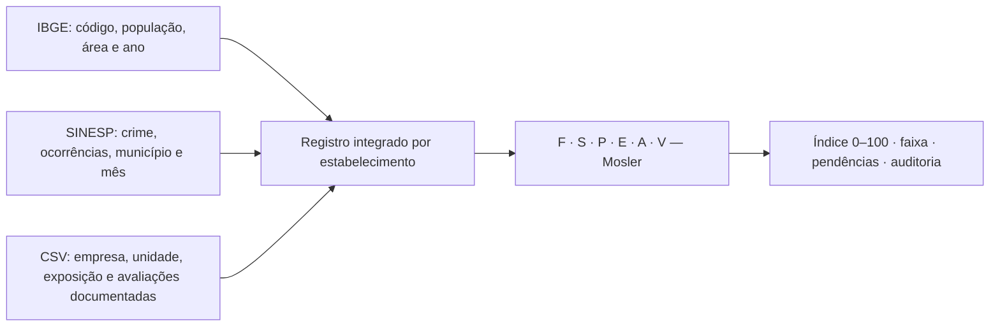

# Índice integrado de segurança: IBGE, SINESP e estabelecimentos

**Projeto:** BB-Dataton / Protege Empresa<br>
**Método:** Mosler com agressão contextual adaptada ao projeto<br>
**Versão:** `mosler-integrado-1.0`<br>
**Data do relatório:** 28/10/2026<br>
**Situação:** metodologia implementada e testada com dados sintéticos; pesos
experimentais, ainda sem calibração por sinistros ou validação com a base completa.

## 1. Resumo para apresentação

Estruturamos uma análise que cruza três conjuntos de dados em cada
estabelecimento: o IBGE caracteriza e identifica o município; o SINESP descreve
as ocorrências criminais publicadas; e o CSV descreve a atividade, os impactos
e a vulnerabilidade da unidade empresarial. As três fontes compõem o mesmo
registro analítico, vinculado pelo código IBGE de sete dígitos.

Adotamos o método Mosler para combinar consequências e condições de ocorrência
do risco. O resultado é um índice de priorização por estabelecimento, de 0 a
100, acompanhado dos critérios utilizados, fontes, período e pendências. Duas
empresas no mesmo município podem ter resultados diferentes por apresentarem
impactos operacionais e vulnerabilidades diferentes.

Definimos pesos iniciais com base na pertinência conceitual das variáveis ao
seguro empresarial. Esses pesos são hipóteses de projeto, documentadas e
editáveis. Não foram estimados a partir dos 2.978 estabelecimentos, de sinistros
ou de uma consulta a especialistas que não ocorreu. A implementação permite
testar a sensibilidade dessas escolhas antes de utilizá-las operacionalmente.

## 2. O cruzamento das três fontes



As fontes têm papéis complementares, sem uma prioridade geral que permita
substituir uma pela outra. A população não substitui ocorrências criminais;
uma taxa municipal não substitui as características da empresa; o cadastro
empresarial não permite inventar ocorrências ausentes.

| Fonte | Campos utilizados | Papel no registro integrado |
|---|---|---|
| IBGE | Código municipal, nome, UF, população, área e anos de referência | Validar o território, normalizar as contagens pela população e contextualizar a densidade. |
| SINESP | Município/UF, natureza do crime, mês, ano, ocorrências e cobertura | Medir a exposição criminal contextual na janela comum de 12 meses. |
| CSV | Empresa, imóvel/unidade, código municipal, exposição da atividade, notas Mosler e evidências | Caracterizar consequências, extensão operacional e vulnerabilidade específicas da unidade. |

O cruzamento usa `many_to_one`: várias unidades podem compartilhar o mesmo
município, mas cada chave empresa/unidade aparece uma única vez. A contagem de
crimes é agregada por município/crime/mês **antes** de se associar às empresas;
ela não é somada novamente a cada estabelecimento. A coorte municipal usada
para suavização e percentis não muda quando o CSV contém mais empresas de uma
mesma cidade.

O identificador final é `(empresa_id, imovel_id)`, preservando
`codigo_ibge_municipio`. Não apresentamos um índice individual como se fosse
um novo indicador oficial do município. Também não generalizamos a média das
empresas do desafio para todos os estabelecimentos da cidade.

## 3. Preparação conjunta do contexto criminal

Para cada município e natureza selecionada, utilizamos os mesmos 12 meses
civis encerrados e calculamos:

\[
T_{m,c}=100.000\times\frac{N_{m,c,12m}}{Pop_m}
\]

O numerador é do SINESP; o denominador é do IBGE. A taxa já é uma variável
construída conjuntamente a partir das duas fontes. Dividir a taxa novamente
pela população ou pela área duplicaria uma normalização sem justificativa.

Aplicamos suavização empírica Gamma-Poisson, com parâmetros estimados na coorte
municipal com dados completos, para reduzir instabilidade de pequenas exposições.
Depois transformamos as taxas suavizadas em percentis com postos médios para
empates. O arquivo de auditoria conserva contagem, taxa bruta, taxa suavizada,
contribuição da observação na suavização e percentil de cada crime.

O estimador usado tem `e_i=pop_i/100000`, `mu=sum(N_i)/sum(e_i)` e
`tau²=max(0,sum((N_i-e_i*mu)²-e_i*mu)/sum(e_i²))`. Se `tau²>0`, utiliza
`beta=mu/tau²` e taxa posterior `(N_i+mu*beta)/(e_i+beta)`.
Essa escolha é uma hipótese de modelagem, não uma correção comprovada de
subnotificação. Quando não há dispersão identificável em uma natureza
selecionada, o contexto fica pendente; não criamos uma posição relativa fictícia.

A densidade `população/área` é apresentada como contexto. Não assumimos que
cidades mais densas sejam necessariamente mais perigosas. Ela não recebe
percentual direto no índice nem é usada como denominador do risco.

Exigimos 12 observações para cada natureza selecionada e população válida com
ano conhecido, não posterior ao ano do período criminal. O mínimo inicial de
30 municípios completos é uma salvaguarda operacional, não prova de validade
estatística. Uma alteração deliberada desse mínimo precisa ficar registrada.

## 4. Pesos que adotamos e por quê

### 4.1 Combinação das naturezas criminais

| Natureza | Peso inicial | Justificativa de projeto | Limite da interpretação |
|---|---:|---|---|
| Roubo de carga | **45%** | Aproximação contextual de exposição ligada à circulação de mercadorias e ao patrimônio empresarial. | Transporte de carga não é equivalente a roubo em loja ou escritório. |
| Roubo de veículos | **35%** | Contexto de mobilidade, ativos transportáveis e circulação operacional. | A pertinência depende do perfil da unidade; não implica que toda empresa possua frota. |
| Roubo seguido de morte — latrocínio | **15%** | Sinal contextual de violência associada ao roubo, sem dominar o componente patrimonial. | Não estima dano a pessoas no estabelecimento nem probabilidade de vitimização. |
| Roubo a instituição financeira | **5%** | Participação residual, pela menor transferibilidade para empresas que não são instituições financeiras. | Para instituições financeiras, o perfil de pesos exige revisão específica. |
| **Total** | **100%** | Preferência metodológica inicial para um perfil empresarial genérico. | Sem comprovação de que esses valores sejam os melhores. |

Se `Q_c` é o percentil municipal de cada natureza, o contexto é:

\[
R_m=0,45Q_{carga}+0,35Q_{veículos}+0,15Q_{latrocínio}+0,05Q_{financeiras}
\]

Os valores exatos 45/35/15/5 são uma **decisão normativa de modelagem**. A
justificativa estabelece uma prioridade conceitual, mas não demonstra que 45%
seja estatisticamente superior a 40% ou 50%. Não utilizamos CRITIC para estimar
esses pesos nesta versão. O CRITIC anterior permanece apenas como modelo
municipal comparativo, separado do novo Mosler integrado.

Antes de usar o contexto, é necessário confirmar no dicionário SINESP que as
naturezas, a unidade de medida e a abrangência escolhidas são comparáveis e
que não há sobreposição indevida. Vítimas, ocorrências, pesos e abrangências
Estadual/PF/PRF não podem ser simplesmente somados. O importador estrito
recusa chaves mensais duplicadas; o leiaute real ainda pode exigir adaptação
explícita para selecionar ou agregar dimensões admissíveis.

### 4.2 Peso do contexto e da atividade no critério Agressão

Convertendo o contexto para a escala 1–5:

\[
A_{municipal}=1+4(R_m/100)
\]

Com `X` representando a exposição da atividade avaliada no CSV, também em 1–5:

\[
A_{contínuo}=0,75A_{municipal}+0,25X
\]

Arredondamos `A_contínuo` para a nota inteira mais próxima, com metade para
cima. Assim, 3,5 vira 4, mantendo a escala inteira 1–5 na fórmula Mosler.

| Entrada de Agressão | Peso | Justificativa |
|---|---:|---|
| Contexto municipal conjunto SINESP/IBGE | **75%** | Dar maior participação à medida criminal territorial publicada e auditável. |
| Exposição da atividade registrada no CSV | **25%** | Incorporar diferenças operacionais sem permitir que uma avaliação isolada substitua todo o contexto territorial. |

Esses 75/25 também são hipóteses. O contexto municipal continua sendo uma proxy
com limitações, mesmo com peso maior. O peso da exposição não é garantia de
correção de um crime inadequado para a atividade. Perfis muito diferentes,
como um escritório, uma transportadora e um banco, precisam de validação
substantiva e eventualmente configurações próprias, versionadas.

Não atribuímos um “percentual global ao IBGE” porque população e código não são
um escore independente de perigo. O IBGE participa de todas as taxas e da
suavização. Os percentuais acima pesam indicadores comparáveis, e não arquivos
brutos. O cruzamento conjunto das fontes não exige que cada uma receba um terço.

## 5. Critérios Mosler por estabelecimento

| Critério | O que avaliamos | Origem e apoio documental | Âncoras da escala adotada |
|---|---|---|---|
| **F — Função** | Quanto um evento comprometeria a função principal da unidade. | CSV, operação descrita, patrimônio, estoque e continuidade. | 1: impacto desprezível; 3: comprometimento parcial relevante; 5: paralisação da função essencial. |
| **S — Substituição** | Dificuldade de repor bens/recursos e restabelecer a função. | CSV e confirmação de reposição, fornecedores e alternativas. | 1: reposição simples e acessível; 3: dificuldade intermediária; 5: substituição inviável ou extremamente difícil no horizonte analisado. |
| **P — Profundidade** | Gravidade das repercussões sobre pessoas, confiança e continuidade das relações. | Avaliação documentada, não inferida automaticamente de CNAE ou cidade. | 1: repercussão mínima; 3: relevante; 5: muito grave e persistente. |
| **E — Extensão** | Alcance geográfico/operacional dos efeitos do evento. | CSV e declaração da abrangência da operação. | 1: efeito individual; 2: local; 3: regional; 4: nacional; 5: internacional. |
| **A — Agressão** | Condições relativas de ocorrência no modelo contextual. | SINESP e IBGE cruzados com exposição da atividade do CSV. | Nota 1–5 calculada pela adaptação descrita acima. Não é probabilidade. |
| **V — Vulnerabilidade** | Fragilidade dos controles de proteção e de resposta da unidade. | Controles efetivamente declarados e verificados no CSV/questionário. | 1: proteção e resposta consistentes; 3: proteção parcial; 5: fragilidade elevada, documentada. |

F, S, P, E e V são notas qualitativas com avaliador, data e evidências. Os níveis
2 e 4 representam situações intermediárias entre as âncoras, com justificativa
obrigatória no registro. A escala é uma operacionalização do projeto; não uma
calibração ou escala universal oficial. Não consultamos especialistas para
preencher essas notas nesta etapa.

O valor de um bem pode ajudar a discutir consequências e reposição, mas sozinho
não define F ou S. Ter vários imóveis não comprova alcance nacional. Uma nota
V não é calculada a partir de renda municipal ou reputação de um bairro.
Informação desconhecida fica ausente; não recebe nota 1, 3 ou 5 por padrão.

A nota de exposição da atividade `X` segue a mesma orientação documentada: 1
para baixa exposição operacional externa de bens/valores; 3 para exposição
intermediária; 5 para circulação/exposição frequente e relevante. Ela descreve
condições de contato/exposição. V descreve fragilidade de controles, evitando
registrar a mesma característica como se fossem duas evidências independentes.

## 6. Fórmula do índice

Preservamos a formulação usual de Mosler:

\[
I=F\times S,\qquad D=P\times E,\qquad C=I+D
\]
\[
PR=A\times V,\qquad ER=C\times PR=(FS+PE)AV
\]

`PR` é o produto operacional de duas notas ordinais, usualmente denominado
“probabilidade” em apresentações do método. Aqui o identificamos como
**produto Agressão–Vulnerabilidade** para não confundi-lo com uma probabilidade
estatística entre 0 e 1.

Não acrescentamos pesos percentuais arbitrários aos seis critérios. Eles já
participam por produtos e soma na estrutura Mosler. Os pesos escolhidos estão
nas variáveis que alimentam A, e isso é identificado como adaptação. F, S, P,
E e V vêm do perfil e das avaliações documentadas da unidade.

Com notas de 1 a 5, o menor ER possível é 2 e o maior é 1.250. A conversão é:

\[
Índice_{0–100}=100\times\frac{ER-2}{1250-2}
\]

É uma transformação da escala, não um percentil nacional nem probabilidade de
sinistro. Zero representa o menor escore possível no modelo, não ausência
comprovada de risco. O produto de escalas ordinais é uma escolha de modelagem
do método: não permite interpretar o dobro do escore como o dobro do risco real.

### Faixas adotadas e compatibilidade com o formulário

| ER Mosler | Faixa Mosler operacional | Faixa simplificada do projeto |
|---|---|---|
| 2 a 250 | Muito baixo | Baixo |
| 251 a 500 | Baixo | Baixo |
| 501 a 750 | Normal | Moderado |
| 751 a 1.000 | Alto | Alto |
| 1.001 a 1.250 | Muito alto | Muito alto |

As faixas do projeto unem as duas primeiras classes. Não reutilizamos os cortes
25/50/75 do antigo índice de percentis para interpretar o Mosler. Guardamos
as duas classificações para evitar confusão. Esses cortes são convenções
operacionais; não demonstram frequência ou severidade esperada de sinistro.

## 7. Exemplo de cálculo para apresentar

**Exemplo inteiramente ilustrativo; não descreve uma empresa da base real.**

Admitindo que o cruzamento SINESP/IBGE produza percentis 80 para carga, 60 para
veículos, 70 para latrocínio e 50 para instituições financeiras:

\[
R_m=0,45(80)+0,35(60)+0,15(70)+0,05(50)=70
\]

Com exposição da atividade `X=4`, obtemos:

\[
A_{municipal}=1+4(70/100)=3,8
\]
\[
A_{contínuo}=0,75(3,8)+0,25(4)=3,85\Rightarrow A=4
\]

Para `F=4`, `S=4`, `P=3`, `E=2` e `V=3`:

\[
ER=[(4\times4)+(3\times2)]\times4\times3=264
\]
\[
Índice=100(264-2)/1248\approx20,99
\]

O resultado está na faixa Mosler **baixo**. O contexto municipal 70 e o índice
final 20,99 medem objetos diferentes; não são dois cálculos concorrentes de
probabilidade. O segundo incorpora consequências e vulnerabilidade da unidade.

No mesmo município, outra unidade com `F=5`, `S=5`, `P=4`, `E=4` e `V=5`, mantendo
`A=4`, teria `ER=820`, índice aproximadamente **65,54**, faixa **alto**.
Isso demonstra como as três fontes se encontram numa avaliação individualizada.

## 8. Qualidade, ausências e sensibilidade

Não multiplicamos o índice por um “peso de confiança”. Isso faria informação
incompleta diminuir artificialmente o risco. Completude, defasagem e qualidade
são apresentadas separadamente.

- Sem município correspondente, população válida, meses completos ou uma nota
  obrigatória documentada, o resultado fica **PENDENTE_DADOS**, com índice nulo.
- Uma contagem zero explicitamente publicada permanece zero; mês ausente não
  recebe zero. A ausência de uma natureza não redistribui automaticamente seu peso.
- População muito antiga e série criminal defasada recebem avisos. A janela e
  os anos de referência permanecem visíveis. População do Censo 2022 não é
  apresentada como estimativa atual.
- Para cada peso de crime e cada peso de Agressão, calculamos cenários com
  variação relativa de **−20% e +20%**, um de cada vez. Os pesos são
  renormalizados apenas nesses cenários explicitamente identificados.
- Registramos mínimo e máximo encontrados, mudança de faixa e cada cenário.
  São cenários de sensibilidade, **não intervalo de confiança**, nem limites
  matemáticos para todas as combinações possíveis de pesos.
- O arredondamento de A pode produzir saltos de escore perto dos limiares.
  A auditoria guarda tanto A contínuo quanto A inteiro para permitir revisão.

Além dessa variação automatizada, a validação deverá avaliar perfis diferentes,
seleção de crimes, escalas qualitativas e estabilidade temporal. Não basta a
faixa ficar estável nos 12 cenários de pesos para considerar o modelo validado.

## 9. Situação dos dados e o que ainda não foi executado

O esquema SQLite e os importadores já existem. Nesta etapa implementamos o
cruzamento e a avaliação Mosler em código, mas não recuperamos o CSV integral
dos 2.978 estabelecimentos nem completamos o banco oficial SINESP/IBGE.
As tentativas anteriores de coleta sofreram bloqueio de rede e desconexão.
Não calculamos um ranking real desses estabelecimentos neste relatório.

O cadastro conhecido do projeto fornece informações financeiras/operacionais,
mas não comprova que existam avaliações F, S, P, E, V, exposição da atividade,
avaliador, data e evidências. Esses campos precisam ser preenchidos a partir
de dados e declarações verificáveis. A implementação não os inventa.

A auditoria versionada na branch `codex/guia-atualizado-personalizacao` registra
um arquivo SINESP 2025 com 31 categorias, sem “roubo em comércio”. Essa informação
foi consultada como registro de outra execução, não como nova inspeção do arquivo
original nesta tarefa. Veículos, carga, bancos e latrocínio continuam sendo
proxies contextuais; não equivalem à frequência de roubo empresarial de cada unidade.

Também faltam avaliação especializada das escalas, calibração, análise de
subnotificação e comparação com desfechos externos. Mais complexidade no
cruzamento não elimina essas limitações.

## 10. Reproduzir a implementação

Arquivos principais:

- `config/seguranca_mosler.json`: pesos, justificativas e versão.
- `seguranca/mosler.py`: cruzamento, fórmula, pendências e sensibilidade.
- `examples/estabelecimentos_mosler_modelo.csv`: somente cabeçalho do CSV; sem dados fictícios de produção.
- `tests/test_mosler_integrado.py`: testes com fixtures sintéticas isoladas.

O CSV consolidado utiliza:

```text
empresa_id, imovel_id, codigo_ibge_municipio,
mosler_f, mosler_s, mosler_p, mosler_e, mosler_v,
exposicao_atividade_1a5, avaliador_mosler,
data_avaliacao_mosler, evidencias_mosler
```

As notas têm valores inteiros de 1 a 5. A data é ISO `AAAA-MM-DD`. Pode-se
acrescentar `uf_real` para validar a compatibilidade entre UF e código municipal.
Preservar os arquivos originais ao preparar esse CSV; avaliações e evidências
adicionadas devem ser distinguíveis dos campos originalmente fornecidos.

Depois de importar os arquivos oficiais e preparar as avaliações documentadas:

```bash
cd /workspace/BB-Dataton
/workspace/.venvs/bb-dataton/bin/python -m seguranca avaliar-mosler \
  --estabelecimentos CAMINHO_DO_CSV_CONSOLIDADO \
  --fim AAAA-MM \
  --data-analise AAAA-MM-DD \
  --saida data/seguranca/mosler
```

Os parâmetros acima são marcadores, não arquivos supostamente baixados. O
comando lê o SQLite em modo somente leitura e gera:

1. `indice_estabelecimentos_mosler.csv`, com uma linha por unidade;
2. `auditoria_mosler.json`, com critérios, contexto, pesos e cenários;
3. `cobertura_mosler.csv`, com calculados e pendentes por município do CSV;
4. `manifesto_mosler.json`, com versão, configuração e hashes das entradas/saídas.

Código de saída 0 significa que todas as unidades puderam ser calculadas;
código 2 sinaliza pendências ou erro. Mesmo o código 0 não significa validação
estatística ou aceitação contratual. O comando municipal anterior `gerar-indice`
mantém o modelo CRITIC de comparação; os arquivos e significados são diferentes.

O novo resultado por unidade ainda precisa ser conectado ao fluxo do formulário
que identifica ou avalia o estabelecimento. A consulta municipal existente
continua sendo apenas contextual; não foi apresentada como se já entregasse
um Mosler individual sem os campos necessários.

## 11. Roteiro curto para a equipe apresentar

> “Nós cruzamos os dados do IBGE, do SINESP e dos estabelecimentos em um registro
> único por unidade. O IBGE fornece o município e a população para normalizar as
> ocorrências, o SINESP descreve o contexto criminal e o CSV caracteriza impactos,
> exposição e vulnerabilidade da operação. Aplicamos Mosler para combinar esses
> elementos. Atribuímos pesos iniciais às naturezas criminais por pertinência ao
> contexto empresarial e documentamos a participação do contexto municipal e da
> atividade no critério Agressão. Esses pesos são hipóteses explícitas, sujeitas
> a análise de sensibilidade. O índice prioriza a análise de proteção; não é uma
> probabilidade de roubo, uma cotação ou uma validação atuarial. A execução com
> a base completa e a calibração externa ainda fazem parte da próxima etapa.”

## 12. Fontes e responsabilidade metodológica

- IBGE, [API de localidades](https://servicodados.ibge.gov.br/api/docs/localidades)
  e [agregado 4714 — Censo 2022](https://sidra.ibge.gov.br/tabela/4714).
- Ministério da Justiça, [página oficial SINESP/VDE](https://www.gov.br/mj/pt-br/assuntos/sua-seguranca/seguranca-publica/estatistica/dados-nacionais-1/base-de-dados-e-notas-metodologicas-dos-gestores-estaduais-sinesp-vde-2022-e-2023).
- Auditoria do projeto em outra branch: [CONFIABILIDADE_SEGURANCA.md](https://github.com/0mthsxz0/BB-Dataton/blob/codex/guia-atualizado-personalizacao/CONFIABILIDADE_SEGURANCA.md).
- Implementações públicas consultadas para referência da formulação Mosler:
  [DanielDS5/mosler](https://github.com/DanielDS5/mosler) e
  [nestorPons/mosler](https://github.com/nestorPons/mosler). São exemplos de software,
  não uma norma oficial ou validação científica dos pesos deste projeto. Não
  incorporamos seu código; a implementação local inclui validações próprias.
- Os pesos 45/35/15/5 e 75/25, a operacionalização das escalas, a normalização
  para 0–100 e a combinação das classes são decisões desta versão do projeto.
  Nenhuma dessas escolhas é atribuída ao IBGE, ao SINESP ou a uma validação
  empírica inexistente.
