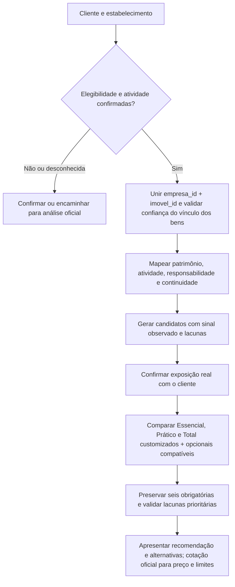

# Mapa das 21 coberturas flexibilizáveis e opcionais

Fonte de produto: Guia_Times_Datathon_Protecao_Inteligente_Final.pdf, seção 10.2, pp. 14–15. Dados: cabeçalhos dos CSVs e dicionário em Seguro_Empresarial_Desenvolvimento. Este material documenta as regras implementadas em opcionais.py e a configuração versionada product-rules.json.

## Fluxo de decisão

As seis obrigatórias permanecem, inclusive Proteção Cibernética. Assistências acompanham o plano e não são customizáveis. Os quatro itens de pacote podem ser incluídos/excluídos na customização de Prático/Total conforme o guia; quatro opcionais de atividade restringem-se a Prático/Total; os demais são opcionais em qualquer plano. A matriz padrão coloca vidros e RC empregador no Total. Confirmar aceitação antes de tratar uma configuração como contratável.

## Junções e limites

- Empresas → estabelecimentos por empresa_id; sinais financeiros por empresa_id + imovel_id. Bens por empresa_id + imovel_id_referencia; validar cardinalidade antes de agregar, preservando confiança e evitando duplicação.
- Território por territorio_id e município/UF/IBGE para referências externas. O CSV território não contém criminalidade ou clima; os índices existentes são triagem, não probabilidade de sinistro.
- Valor ponderado já incorpora o vínculo: não multiplicar novamente pela probabilidade. Faturamento e empregados da empresa podem abranger várias unidades; não atribuir integralmente a cada uma.
- Desconhecido não é ausência. Sinais estimados disparam perguntas, não inclusão automática. Fontes externas exigem período e qualidade próprios.

## Mapeamento completo

| # | Grupo / cobertura | Campos CSV disponíveis | O que o sinal permite | Confirmar com o cliente |
|---|---|---|---|---|
| 1 | **Roubo ou furto de bens mediante arrombamento** — Pacote Prático / Total | `bens_cadastrados: tipo_bem, valor_bem_ponderado_referencia, nivel_confianca_vinculo; sinais_financeiros_operacionais: estoque_medio_estimado` | Bens e estoque indicam patrimônio exposto; cruzar com índice territorial existente. | Controles de segurança, histórico, subtração coberta e valores na unidade. |
| 2 | **Vendaval, furacão, tornado, ciclone e granizo** — Pacote Prático / Total | `enderecos_estabelecimentos: municipio_real, uf_real, codigo_ibge_municipio, padrao_construtivo_cadastrado; bens_cadastrados: valor_bem_ponderado_referencia` | Vincular ao índice climático existente; o CSV territorial sozinho não mede vendaval. | Telhado, manutenção, exposição, granizo e reconstrução. |
| 3 | **Quebra de vidros** — Pacote Prático / Total | `enderecos_estabelecimentos: tipo_unidade, possui_termo_loja, possui_termo_galeria, area_cadastrada_m2, confianca_area` | Sinais de vitrine e área orientam a pergunta; cruzar com índice de vidros. | Presença, dimensão, tipo e valor de reposição dos vidros; loja não comprova vitrine. |
| 4 | **Responsabilidade civil empregador** — Pacote Prático / Total | `empresas: cnae_principal, quantidade_funcionarios_estimada; sinais_financeiros_operacionais: folha_pagamento_mensal` | Folha e atividade orientam relevância; usar índice empregador/NR-4 existente. | Empregados efetivos nesta unidade, tarefas, exposição e medidas preventivas. |
| 5 | **Home Office** — Atividade: Prático / Total | `empresas: dependencia_digital_pct, percentual_vendas_online_estimado; bens_cadastrados: tipo_bem, valor_cadastrado` | Dependência tecnológica orienta pergunta; vendas online não comprovam trabalho remoto. | Trabalho remoto real, equipamentos fora da unidade, propriedade e locais cobertos. |
| 6 | **Delivery** — Atividade: Prático / Total | `empresas: percentual_receita_delivery_est; sinais_financeiros_operacionais: probabilidade_delivery_referencia; empresas: cnae_principal` | Receita e probabilidade estimadas indicam operação a confirmar. | Entregas próprias ou terceirizadas, mercadorias, trajetos e responsabilidade. |
| 7 | **Deterioração de mercadorias em ambientes frigorificados** — Atividade: Prático / Total | `sinais_financeiros_operacionais: probabilidade_refrigeracao_referencia, energia_media_mensal_6m, estoque_medio_estimado, estoque_pico_estimado; bens_cadastrados: tipo_bem` | Refrigeração e estoque sugerem perguntar sobre cadeia fria; energia alta não prova perecíveis. | Mercadoria perecível, temperaturas, equipamentos, alarmes e valor efetivamente refrigerado. |
| 8 | **Roubo ou furto de valores mediante arrombamento** — Atividade: Prático / Total | `sinais_financeiros_operacionais: percentual_recebimentos_digitais; empresas: faturamento_mensal, cnae_principal` | Recebimento não digital é indício indireto; não equivale a dinheiro em caixa. | Numerário real, cofre, permanência, transporte, controles e limites. |
| 9 | **Tumultos, greves e locautes** — Qualquer plano: bens / eventos | `empresas: cnae_principal; enderecos_estabelecimentos: municipio_real, bairro, tipo_unidade` | Atividade e localização ajudam a investigar; CSV não contém histórico desses eventos. | Histórico local, exposição e condições contratuais; não pontuar bairro como prova de risco. |
| 10 | **Recomposição de registros e documentos** — Qualquer plano: bens / eventos | `empresas: dependencia_digital_pct; sinais_financeiros_operacionais: probabilidade_tratamento_dados, pagamentos_software_mensais` | Dependência de registros sugere impacto potencial de perda, sem comprovar custo de recomposição. | Documentos críticos, suporte físico/digital, backups e custo de reconstituição. |
| 11 | **Impacto de veículos terrestres e queda de aeronave** — Qualquer plano: bens / eventos | `enderecos_estabelecimentos: tipo_unidade, logradouro, area_cadastrada_m2` | Características do local apenas orientam inspeção; não há tráfego, recuo ou rota aérea nos CSVs. | Fachada, recuo, barreiras, tráfego e condições do produto. |
| 12 | **Letreiros e anúncios luminosos** — Qualquer plano: bens / eventos | `bens_cadastrados: tipo_bem, valor_cadastrado, probabilidade_bem_no_imovel_referencia, nivel_confianca_vinculo` | Tipo LETREIRO, quando presente, indica bem a validar; cadastro não prova instalação atual. | Existência no local, instalação, dimensões e reposição. |
| 13 | **Derrame acidental de água de sprinklers** — Qualquer plano: bens / eventos | `bens_cadastrados: tipo_bem; enderecos_estabelecimentos: tipo_unidade, area_cadastrada_m2` | SISTEMA_SEGURANCA não confirma sprinkler; tipo de imóvel é apenas contexto. | Existência de sprinkler, manutenção, testes e bens suscetíveis. |
| 14 | **Equipamentos eletrônicos sem cobertura de roubo** — Qualquer plano: bens / eventos | `bens_cadastrados: tipo_bem, valor_cadastrado, valor_bem_ponderado_referencia, nivel_confianca_vinculo; sinais_financeiros_operacionais: indice_dependencia_tecnologica` | Filtrar eletrônicos/informática, agregar uma vez por unidade e verificar concentração de valor. | Inventário, reposição, uso, limites e eventos cobertos. Este adicional não cobre roubo. |
| 15 | **Riscos diversos: bens e mercadorias ao ar livre** — Qualquer plano: bens / eventos | `bens_cadastrados: tipo_bem, valor_bem_ponderado_referencia; sinais_financeiros_operacionais: estoque_medio_estimado; enderecos_estabelecimentos: area_cadastrada_m2` | Existência de bens/estoque não indica se ficam ao ar livre. | Exposição externa real, tempo, proteção física e valores. |
| 16 | **RC garagista (compreensiva)** — Qualquer plano: responsabilidade | `empresas: cnae_principal, descricao_cnae; enderecos_estabelecimentos: tipo_unidade, area_cadastrada_m2` | Atividade compatível pode justificar pergunta sobre guarda de veículos. | Guarda de veículos de terceiros, capacidade, serviços, controles e valores. |
| 17 | **RC danos morais** — Qualquer plano: responsabilidade | `empresas: cnae_principal, descricao_cnae, quantidade_funcionarios_estimada, percentual_receita_delivery_est` | Atividade e interação com terceiros orientam entrevista; não quantificam responsabilidade jurídica. | Atendimento, reclamações, histórico e hipóteses contratuais cobertas. |
| 18 | **Lucro bruto simples** — Qualquer plano: interrupção | `empresas: faturamento_mensal, confianca_faturamento; sinais_financeiros_operacionais: despesa_fixa_mensal_estimada, folha_pagamento_mensal, valor_aluguel_recorrente, compras_fornecedores_media_mensal, estoque_medio_estimado` | Receitas e despesas sinalizam impacto de paralisação; não calculam lucro contábil nem escolhem modalidade. | DRE por unidade, margem bruta/líquida, período indenitário, eventos e definições de simples/ampla. |
| 19 | **Lucro líquido simples** — Qualquer plano: interrupção | `empresas: faturamento_mensal, confianca_faturamento; sinais_financeiros_operacionais: despesa_fixa_mensal_estimada, folha_pagamento_mensal, valor_aluguel_recorrente, compras_fornecedores_media_mensal, estoque_medio_estimado` | Receitas e despesas sinalizam impacto de paralisação; não calculam lucro contábil nem escolhem modalidade. | DRE por unidade, margem bruta/líquida, período indenitário, eventos e definições de simples/ampla. |
| 20 | **Lucro bruto ampla** — Qualquer plano: interrupção | `empresas: faturamento_mensal, confianca_faturamento; sinais_financeiros_operacionais: despesa_fixa_mensal_estimada, folha_pagamento_mensal, valor_aluguel_recorrente, compras_fornecedores_media_mensal, estoque_medio_estimado` | Receitas e despesas sinalizam impacto de paralisação; não calculam lucro contábil nem escolhem modalidade. | DRE por unidade, margem bruta/líquida, período indenitário, eventos e definições de simples/ampla. |
| 21 | **Lucro líquido ampla** — Qualquer plano: interrupção | `empresas: faturamento_mensal, confianca_faturamento; sinais_financeiros_operacionais: despesa_fixa_mensal_estimada, folha_pagamento_mensal, valor_aluguel_recorrente, compras_fornecedores_media_mensal, estoque_medio_estimado` | Receitas e despesas sinalizam impacto de paralisação; não calculam lucro contábil nem escolhem modalidade. | DRE por unidade, margem bruta/líquida, período indenitário, eventos e definições de simples/ampla. |

## Exemplo: eletrônicos de alto valor

1. Confirmar tipos de bens e valor agregado por estabelecimento; usar o valor ponderado como referência provisória, com confiança do vínculo visível.
2. Perguntar sobre o inventário real e os danos de interesse. Danos elétricos já são obrigatórios; identificar o que o adicional de eletrônicos amplia antes de sugeri-lo. Ele não substitui roubo.
3. Se as demais necessidades estiverem atendidas, apresentar Essencial + equipamentos eletrônicos como alternativa ao Prático. Se roubo/vendaval ou outra necessidade relevante persistirem, comparar também Prático/Total com adicionais.
4. Não afirmar economia ou superioridade sem prêmio, franquias, limites e escopo equivalentes. Sem preços no pacote do Datathon, a comparação é de adequação de proteção.

## Uso nas duas interfaces

**Consultor:** sinal observado → campo/arquivo e valor → confiança → cobertura candidata → lacuna → pergunta → alternativas de pacote, com justificativa e limites.

**Cliente da landing page:** coletar as mesmas exposições por perguntas simples, pois não há cadastro CSV vinculado; explicar o benefício e o que falta confirmar. Ex.: “Você tem equipamentos importantes para trabalhar? Podemos avaliar uma proteção adicional para eles; essa opção não inclui roubo.”

## Divergências e estado da implementação

O guia exige Proteção Cibernética fixa; o catálogo CSV não a lista. Seguir o guia e registrar a conciliação. O motor separa as quatro modalidades de lucro, mostra evidências por cobertura e compara alternativas sem preço. As confirmações negativas prevalecem sobre estimativas; nenhuma candidata vira adicional contratado automaticamente. A seleção exige confirmação da exposição e compatibilidade de plano; a modalidade de lucro é única. O mapa abrange 21 itens: quatro ajustáveis e 17 opcionais.
